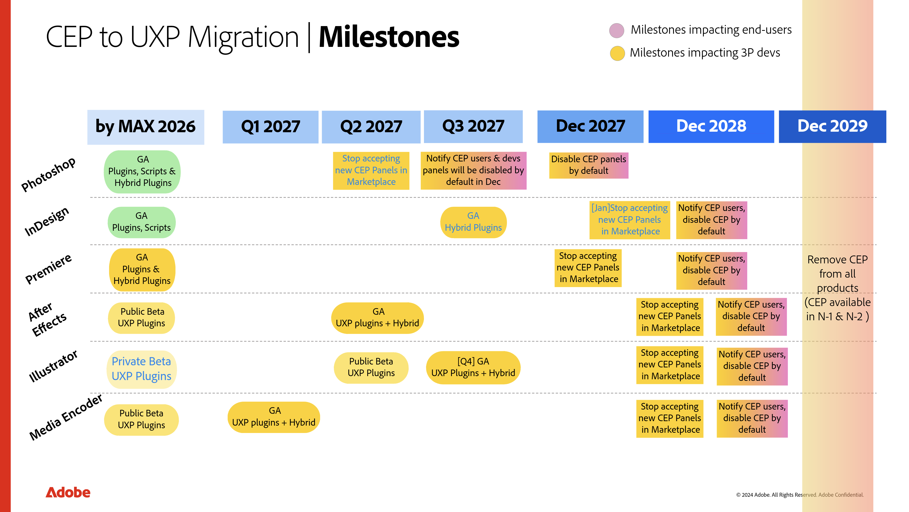

<Superhero slots="heading, text" variant="centered" textColor="white" background="linear-gradient(135deg, #30186E 0%, #6432C8 100%)"/>

# CEP to UXP Migration Center

Planning to move a CEP extension to UXP? Start here for cross-host guidance on packaging, APIs, and manifests.

Technical guidance reviewed: November 4, 2026. Check your minimum host version before choosing APIs.

## Creative Cloud CEP to UXP plugin transition

For FAQs related to how the transition affects Creative Cloud plugins and their users, see [Creative Cloud CEP to UXP plugin transition](https://helpx.adobe.com/creative-cloud/apps/integration-with-other-apps/manage-plugins/cep-uxp-plugin-transition.html).

## CEP to UXP migration milestones

This timeline combines UXP plugin availability with the planned Marketplace and end-user milestones for transitioning existing CEP panels in each application. Yellow marks milestones affecting third-party developers; pink marks changes affecting end users. **GA** means generally available.

### Milestones by application

- **Photoshop:** By MAX 2026, UXP Plugins, UXP Scripts, and UXP Hybrid Plugins reach GA. The Marketplace stops accepting new CEP Panels in Q2 2027. In Q3 2027, users and developers are to be notified that CEP Panels will be disabled by default in December; CEP Panels are scheduled to be disabled by default in December 2027.
- **InDesign:** UXP Plugins and UXP Scripts reach GA by MAX 2026, followed by UXP Hybrid Plugins in Q3 2027. The Marketplace stops accepting new CEP Panels in January 2028. Users are to be notified, and CEP Panels disabled by default, in December 2028.
- **Premiere:** UXP Plugins and UXP Hybrid Plugins reach GA by MAX 2026. The Marketplace stops accepting new CEP Panels in December 2027. Users are to be notified, and CEP Panels disabled by default, in December 2028.
- **After Effects:** UXP Plugins enter Public Beta by MAX 2026 and reach GA, with UXP Hybrid Plugins, in Q2 2027. The Marketplace cutoff for CEP Panels, user notification, and default disabling of CEP Panels are scheduled for December 2028.
- **Illustrator:** UXP Plugins enter Private Beta by MAX 2026 and Public Beta in Q2 2027. UXP Plugins and UXP Hybrid Plugins are scheduled to reach GA in Q4 2027. The Marketplace cutoff for CEP Panels, user notification, and default disabling of CEP Panels are scheduled for December 2028.
- **Media Encoder:** UXP Plugins enter Public Beta by MAX 2026 and reach GA, with UXP Hybrid Plugins, in Q1 2027. The Marketplace cutoff for CEP Panels, user notification, and default disabling of CEP Panels are scheduled for December 2028.

Across products, CEP Panels are scheduled for removal in December 2029; the roadmap notes they remain available in N-1 and N-2. Assuming **N** means the product release in which removal occurs, **N-1** is the immediately preceding release and **N-2** is the release before that. The roadmap does not map these labels to calendar dates or specific host-app versions. Treat the dates as high-level targets.

## How to approach it

There's no single fixed recipe, since every CEP plugin is different, but here's a sample approach that works for most:

1. **Inventory what your CEP extension actually depends on.** Go through your `manifest.xml` and code, and sort what you find into categories: ExtendScript/`evalScript` calls, native CEP functions (`window.cep.fs`, `window.cep.process`, `window.cep.encoding`, `window.cep.util`), CEP JavaScript libraries (`CSInterface`, Vulcan), and any Node.js modules you're relying on through CEP's unrestricted access. This inventory becomes your migration checklist, separate from the code that implements it.
2. **Check what's already built in.** Some features that once required a CEP extension are now native in the latest version of the host application. Confirm before you rebuild anything; you may be able to drop a feature entirely.
3. **Map each remaining item in your checklist to its UXP equivalent.** A few of the most common ones:
  - `window.cep.fs` → entry-based `storage.localFileSystem` or path-based `fs`. Manifest v5's `localFileSystem` permission selects default plugin storage, picker-based `"request"`, or broader `"fullAccess"` within the user's OS access rights. Choose the narrowest permission your workflow needs.
   - `window.cep.process` → UXP has no comprehensive process API; the closest options are `shell.openPath()` and `shell.openExternal()` for launching files and URIs, gated by the `launchProcess` permission in the manifest.
   - ExtendScript/`evalScript` → the host application's UXP DOM API directly. In Photoshop, [`batchPlay`](https://developer.adobe.com/photoshop/uxp/2022/ps-reference/media/batchplay?aio_external) can cover operations that the Photoshop DOM API does not expose. `batchPlay` is Photoshop-specific; use your host's UXP API reference to assess DOM coverage in Premiere, InDesign, and Media Encoder.
   - `CSInterface` → direct calls to host UXP APIs, plus UXP's own lifecycle events (`uxpcreateplugin`, `uxpshowpanel`, and similar) for things CSInterface used events for.
  - Vulcan (cross-plugin messaging) → `invokeCommand()` and `showPanel()` where supported, with manifest v5's `ipc.enablePluginCommunication` permission in the requester. These APIs operate within the same host application; they do not replace Vulcan's cross-application messaging. Check support in your minimum host version.

   See [Migrating Native CEP Functions](uxp-for-cep-devs/technical-migration-guide/index.md#migrating-native-cep-functions) (common across host apps), [Migrating CEP JavaScript Libraries (Photoshop)](uxp-for-cep-devs/technical-migration-guide/index.md#migrating-cep-javascript-libraries), and [Migrating ExtendScript/EvalScript to the Photoshop DOM API](uxp-for-cep-devs/technical-migration-guide/index.md#migrating-extendscriptevalscript-to-the-photoshop-dom-api) in the Technical Migration Guide for the full API-by-API breakdown, including limitations and permission requirements for each.

4. **Rebuild feature by feature.** Start with `manifest.json` and your `entrypoints.setup()` handlers, then work through the UI and each mapped feature. Include the [UI and dependency preflight](uxp-for-cep-devs/technical-migration-guide/index.md#user-interface) and review the [cross-host differences](cross-host-differences/index.md) before reusing CEP libraries or host code.
5. **If a feature still isn't covered**, consider a Hybrid Plugin only where the host supports it. A Hybrid Plugin combines UXP with compiled C++ addons; it is not a drop-in replacement for Node.js native modules or unrestricted subprocess access. Current documented support is **Photoshop 24.2.0+** and **Premiere 26.2+**; InDesign and Media Encoder do not currently support Hybrid Plugins. See the [Hybrid Plugins guide](../guides/how-to/hybrid-plugins/index.md) for platform, architecture, and distribution requirements. Keep future roadmap support separate from capabilities available today.
6. **Test your minimum and current host versions.** Verify permissions, lifecycle callbacks, host mutation/transaction rules, file-token recovery, UI and keyboard behavior, and network or IPC failures on macOS and Windows. Record which host, UXP runtime, UI library, and build-tool versions you actually tested.

## Where to Start

<Cards slots="image, heading, text, links" repeat="1" width="calc(100% / 3)" />

### CEP to UXP Technical Migration Guide

What's different between CEP and UXP, and how to migrate each part of your extension, API by API. Uses Photoshop as its example host application; the common APIs (file I/O, network, shell) apply to any host.

[Read the technical migration guide](uxp-for-cep-devs/technical-migration-guide/index.md)

<Cards slots="image, heading, text, links" repeat="1" width="calc(100% / 3)" />

### UXP for ExtendScript Developers

What changes when you move from ExtendScript and the ExtendScript Toolkit to UXP.

[Read the ExtendScript guide](uxp-for-extendscript-devs/index.md)

<Cards slots="image, heading, text, links" repeat="1" width="calc(100% / 3)" />

### UXP in Photoshop vs Other Host Applications

The main differences to expect when moving a UXP plugin from one host application to another.

[Read the cross-host differences](cross-host-differences/index.md)

## What changes at a glance

- **No embedded Chromium.** CEP ran each extension in its own full Chromium instance. UXP plugins run in a single shared, sandboxed JavaScript engine, with no Chromium Embedded Framework bridge and no `CSInterface`.
- **One JavaScript engine, not two.** CEP split logic between a Chromium panel and ExtendScript host code, connected through `evalScript` calls. UXP plugins call host DOM APIs directly from the same JavaScript context.
- **A new manifest.** `manifest.xml` becomes `manifest.json`. Panel entry points, permissions, and plugin IDs are declared differently; see each host's own UXP API reference for the exact manifest field mapping.
- **Sandboxed by default.** UXP plugins declare file system, network, and launch permissions in the manifest instead of relying on unrestricted Node.js access. A permission does not add a missing Node.js API. Review subprocess/native-code dependencies separately and use the [technical migration guide](uxp-for-cep-devs/technical-migration-guide/index.md#process-apis) to assess alternatives.
- **Native UI controls.** UXP plugins can use Spectrum UI components that match the host application's own interface, instead of hand-styling HTML to approximate it.
